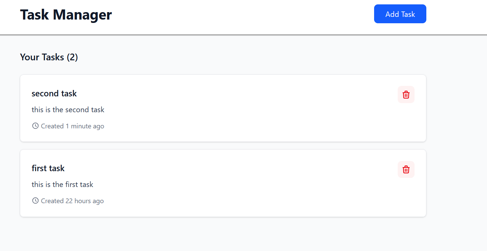
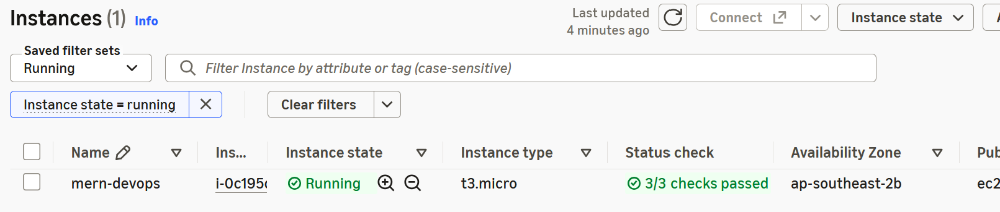

# MERN DevOps Automation Project

A full-stack MERN application deployed using modern DevOps tools and practices, including Docker, Docker Compose, GitHub Actions, AWS EC2, and Kubernetes.

This project demonstrates practical experience in application containerization, CI/CD pipeline configuration, cloud deployment, Linux server administration, and container orchestration.

## Project Overview

The application is a MERN-based Task Manager that allows users to create, view, and delete tasks.

The project focuses on implementing a DevOps workflow around the application, from source code management and containerization to cloud deployment and Kubernetes orchestration.

## Technologies & Tools

| Category | Technologies |
|---|---|
| Frontend | React, Vite |
| Backend | Node.js, Express.js |
| Database | MongoDB Atlas |
| Version Control | Git, GitHub |
| Containerization | Docker |
| Container Management | Docker Compose |
| CI/CD | GitHub Actions |
| Cloud Platform | AWS EC2 |
| Operating System | Amazon Linux 2023 |
| Container Orchestration | Kubernetes |
| Local Kubernetes Environment | Minikube |
| Kubernetes CLI | kubectl |

## Application Features

- Create new tasks.
- View existing tasks.
- Delete tasks.
- Store task data using MongoDB.

## Application Screenshot



## DevOps Architecture

The project demonstrates two deployment environments:

1. AWS EC2 deployment using Docker Compose.
2. Local Kubernetes deployment using Minikube.

### AWS EC2 Deployment Architecture

```text
             Developer
                 |
                 v
             Git / GitHub
                 |
                 v
          GitHub Actions
              CI/CD
                 |
                 v
              AWS EC2
         Amazon Linux 2023
                 |
                 v
           Docker Compose
             /        \
            v          v
        Frontend     Backend
        Container    Container
                         |
                         v
                    MongoDB Atlas
```

### Kubernetes Deployment Architecture

```text
           Docker Images
                 |
                 v
          Minikube Cluster
                 |
                 v
       Kubernetes Deployments
             /        \
            v          v
       Frontend      Backend
          Pod           Pod
            |
            v
      Frontend Service
         NodePort
```

## DevOps Implementation

### 1. Version Control with Git and GitHub

- Managed application source code using Git.
- Hosted the project repository on GitHub.
- Used commits and repository updates to track changes.
- Maintained project source code and configuration files.

### 2. Docker Containerization

- Created separate Dockerfiles for the frontend and backend.
- Built Docker images for application services.
- Containerized application components independently.
- Configured the containers to run the application services.

### 3. Docker Compose

- Created a Docker Compose configuration to manage frontend and backend services.
- Configured port mappings and environment variables.
- Defined service dependencies.
- Used Docker Compose to build, start, stop, and manage multiple containers.

### 4. CI/CD with GitHub Actions

Configured a GitHub Actions workflow to automate parts of the build and deployment process.

The workflow includes:

- Checking out the source code.
- Installing frontend and backend dependencies.
- Running lint checks.
- Building Docker images.
- Establishing an SSH connection to the AWS EC2 instance.
- Executing deployment commands on the remote server.

### 5. AWS EC2 Deployment

Deployed the containerized application to an AWS EC2 instance.

Implementation includes:

- Provisioned an EC2 instance.
- Configured Amazon Linux 2023.
- Installed and configured Docker and Docker Compose.
- Deployed frontend and backend containers.
- Integrated MongoDB Atlas as the cloud database.
- Configured application connectivity and troubleshot deployment issues.

### AWS EC2 Screenshot



### 6. Kubernetes Deployment with Minikube

Deployed the frontend and backend application components to a local Kubernetes cluster using Minikube.

Implementation includes:

- Created Kubernetes Deployments for the frontend and backend.
- Ran application containers inside Kubernetes Pods.
- Exposed the frontend using a NodePort Service.
- Managed Kubernetes resources using kubectl.
- Verified Deployment availability and Pod status.


**Kubernetes Commands**

```bash
kubectl get deployments
kubectl get services
kubectl get pods
kubectl get all
kubectl describe deployment frontend
kubectl describe deployment backend
```

To access the frontend through Minikube:

```bash
minikube service frontend-svc
```

## Project Structure

```text
Mern-Devops-Automation/
│
├── client/
│   ├── Dockerfile
│   └── ...
│
├── server/
│   ├── Dockerfile
│   └── ...
│
├── .github/
│   └── workflows/
│       └── ...
│
├── screenshots/
│   
├── docker-compose.yml
└── README.md
```

## Running the Project Locally

### Prerequisites

- Node.js and npm
- Git
- Docker Desktop
- MongoDB Atlas account or a MongoDB instance

### 1. Clone the Repository

```bash
git clone <YOUR_GITHUB_REPOSITORY_URL>
cd Mern-Devops-Automation
```

### 2. Configure Environment Variables

Create a `.env` file inside the `server` directory:

```env
PORT=5000
MONGO_URI=your_mongodb_connection_string
```

Create a `.env` file inside the `client` directory:

```env
VITE_API_URL=http://localhost:5000/api
```

Replace the MongoDB connection string with your own credentials.

### 3. Build and Start with Docker Compose

Build the Docker images:

```bash
docker compose build
```

Start the application:

```bash
docker compose up -d
```

Check running containers:

```bash
docker compose ps
```

View application logs:

```bash
docker compose logs -f
```

Stop the application:

```bash
docker compose down
```

## Key Learning Outcomes

Through this project, I gained practical experience in:

- Linux server administration.
- Git and GitHub version control.
- Docker image creation and containerization.
- Multi-container application management using Docker Compose.
- CI/CD workflow configuration using GitHub Actions.
- Deploying applications to AWS EC2.
- Connecting containerized applications to MongoDB Atlas.
- Kubernetes Deployments, Pods, Services, and ReplicaSets.
- Managing Kubernetes resources using kubectl.
- Troubleshooting container, networking, environment-variable, and database connectivity issues.

## Future Improvements

- Implement Infrastructure as Code using Terraform.
- Improve Kubernetes configuration using ConfigMaps and Secrets.
- Configure Kubernetes health checks and resource limits.
- Implement monitoring and centralized logging.
- Improve CI/CD automation and deployment verification.
- Configure HTTPS and a reverse proxy.
- Explore managed Kubernetes using Amazon EKS.

## Project Status

**Core implementation completed — ongoing improvements.**

This project represents practical implementation and learning of DevOps tools and workflows, covering containerization, CI/CD, cloud deployment, and Kubernetes orchestration.